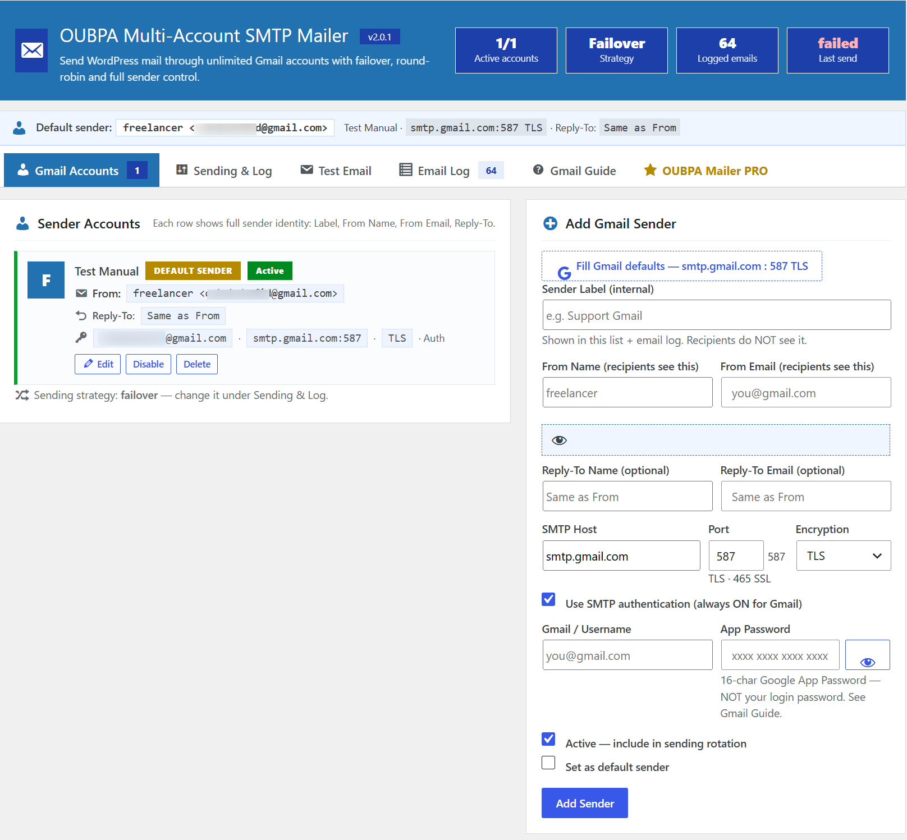
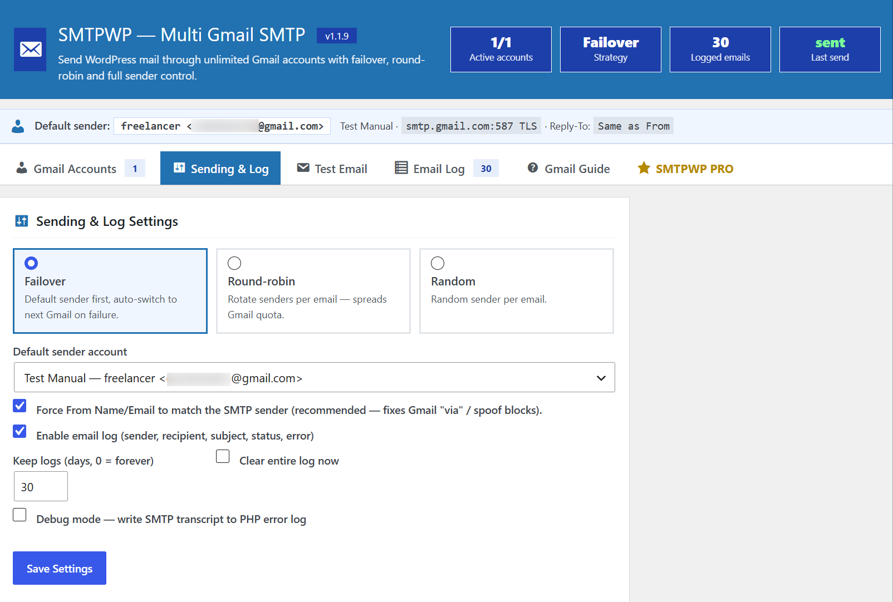
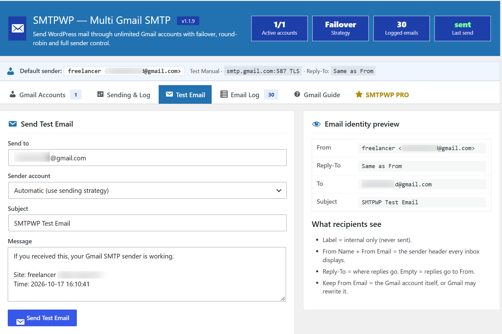
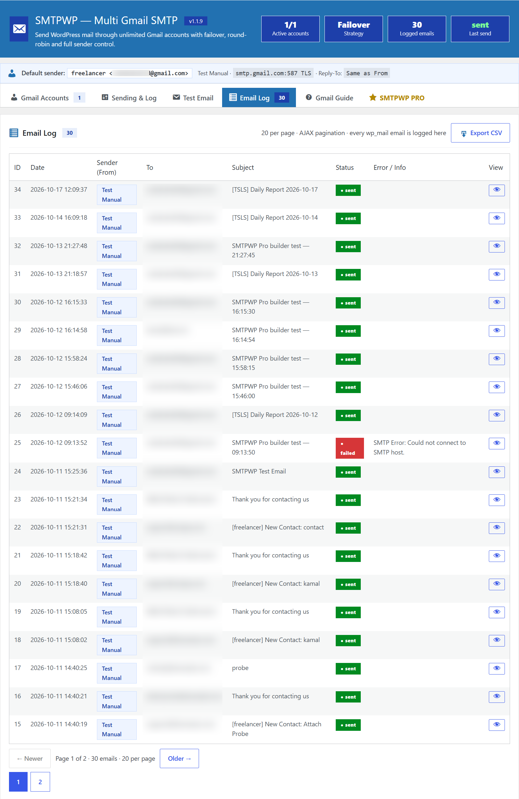

# OUBPA Multi-Account SMTP Mailer

**Version:** 2.0.1
**Requires at least:** WordPress 5.7
**Requires PHP:** 7.4
**License:** GPL-2.0-or-later

OUBPA Multi-Account SMTP Mailer is a lightweight WordPress plugin that sends every email from your site through authenticated Gmail or Google Workspace SMTP instead of the unreliable PHP mail function. Add unlimited Gmail senders and route mail with Failover, Round-robin or Random strategies so your contact forms, WooCommerce orders, password resets and notifications always get delivered — even when one account hits its daily limit. It fixes deliverability by forcing the From header to match the authenticated account, and gives you a full email log with status, recipient and error details, plus a built-in test email tool and a spam-protected contact form.

## Core Features

- **Unlimited Gmail / Google Workspace SMTP accounts** — each with its own label, From name, From email and optional Reply-To.
- **One-click Gmail preset** — `smtp.gmail.com : 587 TLS` (or `465 SSL`).
- **Three sending strategies** — Failover, Round-robin, Random.
- **Automatic failover** — on connection, auth or quota failure the email is retried through the next active account.
- **Force From** — pin the From name and email to the SMTP account for the best Gmail deliverability.
- **Sender identity preview** — see exactly what recipients will see before you send.
- **Test email tool** — send through the automatic strategy or a specific account.
- **Full email log** — date, sender, recipient, subject, status and error for every email.
- **Email viewer** — read the raw text or the rendered HTML of any logged email in a sandboxed iframe.
- **AJAX pagination** — 20 emails per page.
- **CSV export** — download the entire log.
- **Log retention** — auto-prune after N days, or keep forever.
- **Encrypted password storage** — AES-256-CBC via OpenSSL, keyed from your WordPress salts, with a plain-base64 fallback when OpenSSL is unavailable.
- **Debug mode** — writes the full PHPMailer SMTP transcript to the PHP error log.
- **Contact form shortcode** — spam-protected with a nonce and a honeypot.
- **Multiple senders rotation** — route emails through many Gmail accounts.
- **Default sender control** — pin a specific sender or use the first active account.
- **Clean, flat admin UI** — matches the WordPress admin.

## Advanced Features (OUBPA Mailer PRO)

- **Multi-provider SMTP** — Google Workspace, Outlook/Office 365, Amazon SES, SendGrid, Mailgun, Postmark and Brevo.
- **Smart routing rules** — route emails by type (WooCommerce, password resets, contact forms) through their own sender and provider.
- **Rate limits & throttling** — per-sender daily/hourly caps with automatic pause and resume.
- **Health checks & failover** — background connection tests with automatic sender removal and instant recovery.
- **Delivery analytics** — sent, delivered, failed and bounced rates per sender, provider and day.
- **Open & click tracking** — privacy-friendly reporting with per-campaign breakdowns.
- **Email templates** — drag-and-drop template builder with live preview.
- **Attachments support** — attach PDFs, invoices and images to any WordPress email.
- **Scheduled sending** — queue emails and send them at the best time with automatic retries.
- **Bounce & suppression** — automatic bounce handling and a suppression list.
- **REST API & webhooks** — send mail programmatically and push delivery events to Zapier, Make or your own endpoint.
- **Multisite support**
- **Import / export settings**
- **Automatic updates**
- **Priority support**

## Instructions

1. Install and activate the OUBPA Multi-Account SMTP Mailer plugin from your WordPress dashboard.
2. Open the Gmail Guide tab and follow the steps to enable 2-Step Verification on your Google account.
3. Create a Google App Password for the account and copy the 16-character code.
4. Go to the Gmail Accounts tab, click Fill Gmail defaults, then enter a label, the From name, the From email, the Gmail username and the App Password.
5. Repeat step 4 for every additional Gmail sender you want in the rotation.
6. Choose a sending strategy (Failover, Round-robin, Random) and an optional default sender under Sending & Log.
7. Send a Test Email to confirm everything works.
8. Keep log enabled to review every sent email, and enable Debug mode only while troubleshooting.

## Screenshots

## Contact

- Author: Themestar Teams
- Contact: https://oubpa.com/contact
- Store: https://oubpa.com/shop
